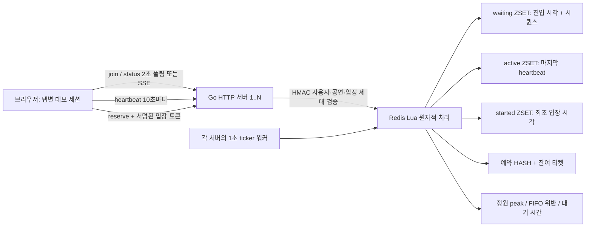

# Ticketing System · Virtual Waiting Room

Go + Redis로 구현한 티켓 예매 데모입니다. **공연별 최대 1,000명**만 구매 페이지에 입장하고, 나머지는 FIFO 대기열에 머뭅니다. 정원, heartbeat 만료, 최대 체류 시간은 설정 가능합니다.

정적 HTML/JS 대기 화면, HMAC 입장 토큰, 중복 예약 방지, 실 Redis 통합 테스트와 10,000명 HTTP 부하 테스트가 포함됩니다. 실제 결제·좌석 선택·회원 로그인은 구현 범위에 포함되지 않습니다.

## 바로 실행하기

### 현재 작업 폴더에서

이 작업 환경에는 Go와 Redis를 `.tools/`에 준비했습니다. 해당 폴더는 Git에 포함되지 않습니다.

```sh
./scripts/demo.sh
```

[데모 열기](http://127.0.0.1:8080/?event=demo-2). 데모 스크립트는 정원을 **2명**으로 설정하므로 탭 3개만으로 대기를 확인할 수 있습니다. 서버 설정 기본값은 1,000명입니다. 이미 8080 포트를 사용 중이면 기존 서버를 종료하거나 `HTTP_ADDR=127.0.0.1:8081 ./scripts/demo.sh`로 실행합니다.

1. 화면의 **대기실 입장하기**를 누릅니다.
2. **새 사용자 탭**으로 2개를 더 열고 입장합니다. 세 번째 사용자는 기다립니다.
3. 첫 번째 탭에서 **예약하기** 또는 **나가기**를 누르면 다음 사용자가 입장합니다.
4. **heartbeat 중단**을 체크하거나 탭을 닫으면 마지막 heartbeat로부터 30초 뒤 자리가 반환됩니다. 워커·화면 갱신 때문에 화면 반영에는 수초가 추가될 수 있습니다.
5. 새로고침해도 같은 사용자·순번이 유지됩니다. 브라우저의 **탭 복제**는 sessionStorage가 복제될 수 있어 같은 사용자 테스트에 쓸 수 있습니다. 확실히 새 사용자를 만들려면 화면의 **새 사용자 탭**을 사용하세요.
6. **SSE 모드**로 전환해 서버 스트림 방식도 확인할 수 있습니다.

`demo.sh`는 로컬 Redis 16380 포트와 `.tools/demo-redis`를 사용합니다. 종료 시 자신이 시작한 Redis만 종료하고 데이터는 보존합니다. 데모 HMAC 키도 `.tools/demo-secret`에 보존합니다.

### 다른 컴퓨터: Docker Compose

Docker Compose가 설치되어 있어야 합니다.

```sh
cp .env.example .env
# 출력한 값을 .env의 TOKEN_SECRET= 뒤에 붙여넣으세요.
openssl rand -hex 32
docker compose up --build
```

[기본 화면](http://127.0.0.1:8080/?event=demo)을 엽니다. 탭 테스트를 위해 `.env`에서 `ACTIVE_LIMIT=2`로 바꾸려면 **첫 실행 전에** 설정하세요. 이미 등록된 공연의 정원 설정을 변경하면 안전을 위해 `CONFIG_MISMATCH`로 시작이 거부됩니다. 새 테스트에는 `EVENT_IDS=demo-small`처럼 새 공연 ID를 사용합니다.

Compose Redis는 AOF 데이터를 볼륨에 보존합니다. `docker compose down`은 볼륨을 삭제하지 않습니다. 이 컴퓨터에는 Docker가 없어 Compose 빌드는 실행하지 않았으며, 실제 검증은 네이티브 Go/Redis로 진행했습니다.

### Go / Redis 직접 실행

Go 1.26 이상, Redis 7 이상이 필요합니다. 검증 버전은 Go 1.27.2, Redis 7.2.7입니다.

```sh
redis-server --bind 127.0.0.1 --port 16379 --appendonly yes --maxmemory-policy noeviction
# 다른 터미널
export TOKEN_SECRET="$(openssl rand -hex 32)"
export REDIS_URL=redis://127.0.0.1:16379/0
go run ./cmd/server
```

여러 서버는 같은 Redis, `TOKEN_SECRET`, 공연 설정을 사용하고 `HTTP_ADDR`만 다르게 설정합니다. 영속 환경에서는 비밀 키를 재시작마다 새로 만들지 말고 안전하게 보관하세요.

## 구조



### 왜 Sorted Set인가?

- `waiting`의 member는 사용자 ID 하나입니다. `ZRANK`로 현재 순번을 얻고, `ZRANGE`로 선두부터 가져옵니다. 기존 사용자는 재진입 시 score를 수정하지 않습니다.
- score는 Redis 시각의 밀리초 × 1,000과 `INCR(sequence)` 중 큰 값입니다. 같은 밀리초에 수천 명이 도착하거나 시계가 뒤로 움직여도 증가합니다. 큰 epoch 값에 소수를 더하는 방식의 정밀도 손실을 피합니다. IEEE-754 정수 정밀도 범위 내 값을 사용하며 JSON에서는 ticket을 문자열로 전달합니다.
- `active`의 score는 마지막 heartbeat 시각입니다. `ZRANGEBYSCORE`로 만료 후보를 효율적으로 찾습니다.
- `started`를 따로 둬서 heartbeat로 최초 입장 시각을 덮어쓰지 않습니다. 계속 heartbeat를 보내도 10분 체류 제한을 우회할 수 없습니다.

여기서 선착순은 **Redis가 join을 직렬 처리한 순서**입니다. 인터넷상의 클릭 시각이나 Go 고루틴 시작 순서를 보장한다는 뜻이 아닙니다. [Redis Sorted Set 문서](https://redis.io/docs/latest/develop/data-types/sorted-sets/)

### 왜 Lua인가?

애플리케이션에서 `ZCARD → 빈자리 계산 → ZREM → ZADD`를 각각 호출하면 여러 서버가 같은 빈자리를 보고 동시에 입장시킬 수 있습니다. 이 구현에서는 **만료 처리 → 빈자리 계산 → 대기열 선두 제거 → 입장자 추가 → 지표 기록**을 한 Lua 실행으로 처리합니다.

정원이 C, 실행 직전 입장자가 A명이면 `min(C-A, 대기자 수, 1000)`명만 추가합니다. 동일 Redis primary에서 모든 입장 변경이 이 스크립트를 통과하므로 정원을 넘지 않습니다. 신규 join은 자리가 비어 있어도 먼저 줄에 서며, 입장은 워커만 담당합니다. 따라서 기존 대기자를 추월할 수 없습니다.

워커를 여러 대에서 실행해도 분산 락이나 리더 선출이 필요하지 않습니다. 공연별 설정도 Redis에 기록해 서로 다른 정원으로 실행한 서버를 차단합니다. 스크립트 하나당 입장·만료 처리를 각각 최대 1,000명 단위로 제한해 Redis 장기 점유를 줄였습니다. [Redis Lua 원자성 문서](https://redis.io/docs/latest/develop/programmability/eval-intro/)

키는 `vwr:{event-id}:waiting`처럼 같은 hash tag를 씁니다. 하나의 공연에 필요한 키가 같은 슬롯에 위치하도록 설계했지만, 현재 연결 코드는 단일 Redis 클라이언트이며 Cluster 배포 검증은 하지 않았습니다.

### 퇴장과 예약

- **명시적 퇴장**: leave로 active·started·generation 또는 waiting 항목을 제거합니다. 예약 성공도 같은 Lua 안에서 자리를 반환합니다.
- **암묵적 퇴장**: `last_heartbeat <= now-30s` 또는 `admitted_at <= now-10m`이면 만료됩니다. 빈자리는 다음 워커 tick에 채워집니다.
- **경계 경쟁**: heartbeat, status, reserve도 유효 기간을 검사합니다. 워커가 늦더라도 만료된 토큰으로 구매하거나 늦은 heartbeat로 부활할 수 없습니다.
- **서명 토큰**: HMAC-SHA256 + 버전 + 목적 구분. 사용자, 공연, 입장 세대, 만료 시각을 포함합니다. 세션 토큰은 입장 토큰으로 사용할 수 없습니다.
- **현재 입장 확인**: reserve는 서명 확인 후 Redis에서 현재 active와 generation을 다시 확인합니다. 퇴장·재입장 후 이전 토큰은 거부합니다.
- **중복 예약 방지**: 재고 차감과 사용자별 예약 저장도 Lua 한 번으로 실행합니다. 같은 입장 세대의 재요청은 같은 예약 번호를 반환하고 재고를 다시 차감하지 않습니다. 응답 유실 시 status로도 예약 번호를 복구할 수 있습니다.
- **장애 시**: Redis 오류에는 HTTP 503을 반환하며 입장이나 예약을 허용하지 않습니다.

실제 운영은 검증된 로그인 사용자의 ID를 사용해야 합니다. 현재 `/session`은 탭 테스트용 무작위 사용자 세션을 발급합니다. 한 세션의 중복 줄서기는 막지만, 익명 사용자가 여러 세션을 발급받는 봇 방어는 구현하지 않았습니다.

### 순번·예상 시간·SSE

`position`은 현재 대기열의 1부터 시작하는 순번, `ahead = position-1`입니다. 입장 시에는 둘 다 0입니다. `ticket`은 최초 진입 순서를 나타내는 변하지 않는 내부 순서 값입니다.

예상 시간은 `(position × 관측된 평균 체류 시간) / ACTIVE_LIMIT`입니다. 퇴장 표본이 없으면 `null`/“계산 중”을 표시합니다. 진행률은 처음 표시한 순번 대비 감소량이며 완료 시각 보장이 아닙니다.

기본은 2초 HTTP 폴링입니다. `?event=demo&transport=sse`에서는 Authorization 헤더를 지원하는 `fetch` 스트림으로 SSE를 사용합니다. 단절되면 폴링으로 전환합니다. SSE 연결은 heartbeat를 대신하지 않습니다. 현재 SSE도 서버에서 Redis를 2초마다 조회하므로 Redis 조회량 감소를 주장하지 않습니다. 향후 워커의 변경 알림 + Pub/Sub + 재접속 시 상태 재조회로 개선할 수 있습니다.

대기 중 탭을 닫은 사람은 순번을 유지하다가, 자신의 입장 차례에 heartbeat가 없으면 30초 뒤 퇴장합니다. 대기자 자체를 heartbeat로 삭제하지 않는 것은 새로고침·재접속 순번 보존을 위한 선택이며, 긴 대기열에서 유령 대기자를 즉시 제거하는 별도 정책은 없습니다.

## API

먼저 `POST /session`으로 `{user_id, session_token}`을 받고 이후 요청에 `Authorization: Bearer <session_token>`을 보냅니다. 요청 body는 필요하지 않습니다.

| 메서드 | 경로 | 결과 |
|---|---|---|
| POST | `/session` | 24시간 데모 세션 발급 |
| POST | `/events/{id}/queue` | 중복 없는 join, position/status |
| GET | `/events/{id}/queue/status` | 순번, ahead, 예상 시간, 입장 토큰 |
| GET | `/events/{id}/queue/stream` | `event: status` SSE, 2초마다 현재 상태 |
| POST | `/events/{id}/queue/heartbeat` | 입장 lease 갱신, 현재 상태 반환 |
| POST | `/events/{id}/queue/leave` | 멱등 퇴장, HTTP 204 |
| POST | `/events/{id}/reserve` | `X-Admission-Token` 필수, 예약 번호 |
| GET | `/healthz` | Redis 접근 상태 |

대기 응답 예시:

```json
{"status":"waiting","position":1234,"ahead":1233,"estimated_wait_seconds":148,"ticket":"1791760000000001"}
```

입장 응답에는 `status: "admitted"`, `position: 0`, `token`, `expires_at`(Unix ms)이 포함됩니다. 그 밖에 `absent`, `expired`, `completed` 상태가 있습니다. `completed`에는 `reservation_id`가 포함됩니다.

오류: 인증 없음/만료 401, 토큰 없음/변조/입장 만료 403, 없는 공연 404, 매진/이미 예약 409, Redis 장애/설정 충돌 503. 세션과 입장 토큰을 URL에 넣거나 로그에 기록하지 마세요.

```sh
# HTTP 예시: SESSION에는 /session 응답의 session_token을 넣습니다.
curl -X POST http://127.0.0.1:8080/session
curl -X POST -H "Authorization: Bearer $SESSION" http://127.0.0.1:8080/events/demo/queue
curl -H "Authorization: Bearer $SESSION" http://127.0.0.1:8080/events/demo/queue/status
curl -X POST -H "Authorization: Bearer $SESSION" -H "X-Admission-Token: $ADMISSION" http://127.0.0.1:8080/events/demo/reserve
```

## 설정

| 환경 변수 | 기본값 | 의미 |
|---|---|---|
| `ACTIVE_LIMIT` | `1000` | 공연별 정원, 1~100000 |
| `HEARTBEAT_TIMEOUT` | `30s` | 마지막 heartbeat 만료 간격 |
| `MAX_STAY` | `10m` | 최초 입장부터 최대 체류 시간 |
| `WORKER_INTERVAL` | `1s` | 각 서버의 입장/정리 주기 |
| `TOKEN_SECRET` | 없음, 필수 | 32바이트 이상 HMAC 키, 모든 서버 동일 |
| `REDIS_URL` | `redis://127.0.0.1:6379/0` | Redis 주소, 인증/TLS URL 지원 |
| `HTTP_ADDR` | `127.0.0.1:8080` | HTTP 바인딩 |
| `EVENT_IDS` | `demo` | 허용된 공연 ID, 쉼표 구분 |
| `EVENT_TICKETS` | `10000` | 공연 최초 등록 시 티켓 수, 재시작 시 재설정하지 않음 |

브라우저 heartbeat 간격은 10초입니다. 타임아웃을 이보다 짧게 설정하려면 프론트엔드 간격도 함께 조정해야 합니다.

## 테스트

Mock Redis가 아닌 **실제 Redis**를 사용합니다. Redis가 없으면 테스트를 건너뛰지 않고 실패합니다. 테스트는 고유한 `test-*`/`http-*`/`stream-*` 공연만 정리하며 `FLUSHDB`는 사용하지 않습니다.

```sh
# Redis가 16379에 실행 중인 상태에서
go test -race -count=1 ./...
go vet ./...
# 시스템 Go 대신 현재 작업 폴더의 Go를 사용할 때
./scripts/go-local.sh test -race -count=1 ./...
# 다른 Redis 주소
REDIS_ADDR=127.0.0.1:6379 go test -race ./...
```

검증 항목:

- 10,000개 동시 join + 독립 Redis 연결을 사용하는 워커 4개: active 1000, waiting 9000, peak ≤1000, FIFO 위반 0.
- 입장자 100명 퇴장: 1001~1100번 정확히 입장.
- 주입 가능한 시계: 29초 유지, 30초 만료 및 자리 승계, 최대 체류 시간 만료, 늦은 heartbeat 부활 금지.
- 같은 사용자의 100개 동시 join과 입장 후 join: 중복 없음.
- 빈자리 발생 후 신규 사용자 끼어들기 차단, Redis 시계 역행 시 FIFO 유지.
- 토큰 위조, 목적 혼동, 다른 사용자/공연, 퇴장 및 재입장 후 이전 토큰 차단.
- 20개 동시 예약 요청과 재시도: 재고 1장, 예약 1개.
- SSE 인증된 입장 상태/토큰 전송과 연결 종료, 정적 파일 제공.

GitHub Actions에서도 `go vet`, `go test -race -count=1 ./...`, 10,000명 부하 테스트가 모두 통과했습니다. [검증 실행 결과](https://github.com/jsim84747/ticketing-system/actions/runs/38186910621) · 검증한 코드 커밋: `545e0a5`.

## 부하 테스트와 결과

```sh
# 필요 시 macOS의 파일 디스크립터 한도를 현재 셸에만 조정
ulimit -n 8192
./scripts/loadtest.sh -users 10000 -limit 1000 -instances 4 -seed 42 > benchmarks/my-run.json
```

서로 독립된 HTTP 서버·Redis 클라이언트·워커 4개를 한 Go 프로세스 안에 띄웁니다. 10,000개 join 고루틴을 동시에 시작하고 실제 HTTP 요청으로 인증과 join을 거칩니다. HTTP 연결은 서버당 64개로 제한하고 나머지 요청은 클라이언트에서 대기합니다. **10,000개 TCP 연결을 동시에 유지하는 테스트는 아닙니다.** 첫 시도는 macOS accept backlog 한도에서 연결 reset이 발생해 연결 수를 제한했고, 실패한 시도는 성공 수치에 섞지 않았습니다.

진입 후 200ms마다 현재 입장자 중 무작위 1~500명을 HTTP leave로 퇴장시키며, 10초마다 생존 입장자에게 heartbeat를 보냅니다. 정원 또는 FIFO 위반, 요청 오류, 총 입장 인원 불일치가 있으면 종료 코드 1로 실패합니다. 전용 `load-<random-id>` 공연만 만들고 종료 시 그 키만 정리합니다.

**2026-10-11 로컬 측정** — macOS arm64, Go 1.27.2, Redis 7.2.7, GOMAXPROCS 10, 서버 4개, 각 워커 1초, seed 42. [원본 JSON](benchmarks/local-10000.json)

| 지표 | 결과 |
|---|---:|
| 전체 입장 처리 | 10,000명 |
| 최대 동시 입장자 | **1,000명** |
| FIFO 순서 위반 | **0건** |
| HTTP / 워커 오류 | **0건** |
| 평균 대기 시간 | 5,576.21 ms |
| 최대 대기 시간 | 10,787 ms |
| 전체 시나리오 처리량 | 805.66명/초 |
| 10,000개 join 응답 완료 | 0.209초 |
| 진입부터 전원 퇴장까지 | 12.412초 |
| 종료 시 active / waiting | 0 / 0 |

대기 시간은 Redis가 join을 확정한 시각부터 입장까지이며 클라이언트의 연결 대기 시간은 제외합니다. 처리량은 총 입장자 수 ÷ 시나리오 전체 소요 시간입니다. 무작위 퇴장 패턴과 1초 tick에 영향을 받는 **시나리오 수치**이며 Redis/HTTP의 포화 처리량이 아닙니다. 세션 발급 준비도 측정 구간에서 제외했습니다. 멀티 호스트 네트워크, 장시간 부하, 장애 복구 벤치마크는 수행하지 않았습니다.

### GitHub Actions 교차 검증

2026-10-11 (미국 동부 시간) GitHub Linux amd64 러너에서도 동일한 시나리오를 실행했습니다. Go 1.27.2, Redis 7.2.7, GOMAXPROCS 2, HTTP 서버 4개입니다. [CI 원본 JSON](benchmarks/github-ci-10000.json)

| 지표 | 결과 |
|---|---:|
| 전체 입장 처리 | 10,000명 |
| 최대 동시 입장자 | **1,000명** |
| FIFO 순서 위반 / HTTP·워커 오류 | **0 / 0건** |
| 평균 / 최대 대기 시간 | 5,176.66 / 10,109 ms |
| 전체 시나리오 처리량 | 799.42명/초 |
| 전체 소요 시간 | 12.509초 |

로컬과 CI의 CPU·OS가 달라 수치는 다르지만 정원과 FIFO 조건은 모두 통과했습니다. 두 실행 모두 앞서 설명한 동일한 부하 모델의 측정 한계가 적용됩니다.

## 면접에서 설명하기

> “입장 정원은 분산 서버의 로컬 카운터로 관리하지 않고 Redis를 유일한 기준으로 사용했습니다. 대기 순서와 중복 확인에는 Sorted Set을 사용하고, 만료 제거부터 빈자리 계산과 입장까지 Lua 한 번으로 처리해 여러 워커가 같은 자리를 중복 배정하지 못하게 했습니다. 토큰은 입장 사실을 증명하지만 퇴장 후에도 남을 수 있어서, 실제 예약 시 현재 lease와 입장 세대를 Redis에서 함께 확인합니다.”

예상 시간은 추정임을 명시하고, race detector 통과와 분산 정원 보장은 다른 검증이라고 설명하세요. 전자는 Go 메모리 경쟁 검사이며, 후자는 Lua 원자성과 실 Redis 동시성 테스트로 확인합니다.

## 운영 범위와 한계

- 단일 Redis primary가 일관된 상태를 유지하고 모든 입장이 이 경로를 통과하는 조건에서 정원을 보장합니다. Redis failover로 미복제 데이터가 유실되는 상황까지 절대 보장을 주장하지 않습니다. AOF everysec는 장애 시 최근 쓰기가 유실될 수 있습니다.
- Redis eviction은 대기·입장 상태를 깨뜨릴 수 있어 `noeviction`을 사용합니다. 용량·지연 모니터링, 백업, 접근 제어와 TLS를 운영 환경에서 구성해야 합니다. Lua는 다른 요청과의 원자성을 제공하지만 실행 중 오류에 대한 트랜잭션 rollback은 제공하지 않습니다.
- 이 프로젝트의 예약/재고는 Redis 기반 데모입니다. 실제 결제에는 영속 DB, 결제 멱등성, 예약 유효 기간, 취소·보상 절차가 추가로 필요합니다.
- 실사용 배포 전 인증 시스템과 rate limit/봇 방어를 추가하세요. HTTP 서버는 기본 localhost에만 바인딩합니다.
- 공연 키는 순서·설정·예약 보존을 위해 자동 만료시키지 않습니다. 공연 종료 시 업무 보존 정책에 따라 정리하는 운영 절차가 필요합니다.
- 브라우저의 백그라운드 탭 타이머 절전으로 heartbeat가 지연될 수 있습니다. 현재 정책은 마지막 수신 시각 기준 30초를 엄격히 적용합니다.

## 파일과 개발 흐름

- `internal/queue/queue.lua`: FIFO, 정원, lease, 원자적 예약
- `internal/queue/store.go`: Redis 호출, 주입 가능한 clock, ticker 워커
- `internal/auth/`: HMAC 서명과 검증
- `internal/httpapi/`: API, SSE, 정적 웹 화면
- `cmd/server/`: 설정, 실행, 정상 종료
- `cmd/loadtest/`: HTTP 부하 테스트 및 불변 조건 검사
- `benchmarks/`: 실제 측정 결과

작업은 요청한 6단계로 나눠 테스트 후 커밋했습니다: 진입/조회 → 워커/정원 → heartbeat/만료 → 토큰/예약 → 웹/SSE → 부하 테스트/문서. 변경할 때는 해당 통합 테스트와 `go test -race ./...`를 통과시킨 뒤 커밋하세요.
