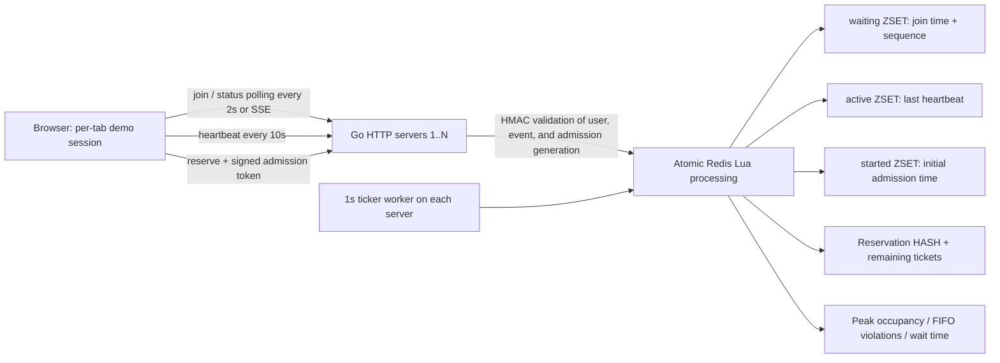

Ticketing System · Virtual Waiting Room

A ticket-booking demo implemented in Go + Redis. Only **up to 1,000 users per event** can enter the purchase page; everyone else remains in a FIFO queue. Capacity, heartbeat expiration, and maximum stay duration are configurable.

Includes a static HTML/JS waiting screen, HMAC admission tokens, duplicate reservation prevention, integration tests against real Redis, and an HTTP load test with 10,000 users. Actual payment processing, seat selection, and member login are outside the implementation scope.

## Quick Start

### In the Current Working Directory

Go and Redis have been prepared in `.tools/` in this workspace. This directory is not included in Git.

```sh
./scripts/demo.sh
```

[Open the demo](http://127.0.0.1:8080/?event=demo-2). The demo script sets capacity to **2 users**, so you can see the queue with just three tabs. The server's default capacity is 1,000 users. If port 8080 is already in use, stop the existing server or run `HTTP_ADDR=127.0.0.1:8081 ./scripts/demo.sh`.

1. Click **Join Waiting Room** on the screen.
2. Open two more tabs using **New User Tab** and join. The third user waits.
3. Click **Reserve** or **Leave** in the first tab to admit the next user.
4. Check **Stop Heartbeat** or close the tab, and the slot is released 30 seconds after the last heartbeat. Worker execution and screen refreshes may add a few seconds before the change appears on screen.
5. Refreshing preserves the same user and queue position. The browser's **Duplicate Tab** feature may copy sessionStorage, so it can be used to test the same user. To reliably create a new user, use **New User Tab** on the screen.
6. Switch to **SSE Mode** to try server streaming as well.

`demo.sh` uses local Redis on port 16380 and `.tools/demo-redis`. On exit, it stops only the Redis instance it started and preserves the data. The demo HMAC key is also preserved in `.tools/demo-secret`.

### On Another Computer: Docker Compose

Docker Compose must be installed.

```sh
cp .env.example .env
# Paste the generated value after TOKEN_SECRET= in .env.
openssl rand -hex 32
docker compose up --build
```

Open the [default screen](http://127.0.0.1:8080/?event=demo). To change `.env` to `ACTIVE_LIMIT=2` for tab testing, set it **before the first run**. If you change the capacity configuration for an event that is already registered, startup is rejected with `CONFIG_MISMATCH` as a safety measure. Use a new event ID for a new test, such as `EVENT_IDS=demo-small`.

Compose Redis preserves AOF data in a volume. `docker compose down` does not delete the volume. Docker was unavailable on this computer, so the Compose build was not run; actual validation used native Go/Redis.

### Run Go / Redis Directly

Requires Go 1.26 or later and Redis 7 or later. The validated versions were Go 1.27.2 and Redis 7.2.7.

```sh
redis-server --bind 127.0.0.1 --port 16379 --appendonly yes --maxmemory-policy noeviction
# In another terminal
export TOKEN_SECRET="$(openssl rand -hex 32)"
export REDIS_URL=redis://127.0.0.1:16379/0
go run ./cmd/server
```

Multiple servers must use the same Redis instance, `TOKEN_SECRET`, and event configuration, with only `HTTP_ADDR` set differently. In a persistent environment, store the secret securely instead of generating a new one on every restart.

## Architecture



### Why Sorted Sets?

- Each member of `waiting` is a single user ID. `ZRANK` provides the current queue position, and `ZRANGE` retrieves users from the front. An existing user's score is not changed when they rejoin.
- The score is the greater of Redis time in milliseconds × 1,000 and `INCR(sequence)`. It increases even when thousands of users arrive in the same millisecond or the clock moves backward. This avoids the precision loss caused by adding fractions to large epoch values. Values stay within the IEEE-754 integer precision range, and ticket is passed as a string in JSON.
- The score in `active` is the last heartbeat time. `ZRANGEBYSCORE` efficiently finds expiration candidates.
- `started` is kept separately so that heartbeats do not overwrite the initial admission time. Sending heartbeats continuously cannot bypass the 10-minute stay limit.

Here, first-come, first-served means **the order in which Redis serializes join operations**. It does not guarantee the order of clicks over the internet or the order in which Go goroutines start. [Redis Sorted Set documentation](https://redis.io/docs/latest/develop/data-types/sorted-sets/)

### Why Lua?

If the application calls `ZCARD → calculate available slots → ZREM → ZADD` separately, multiple servers may see the same available slot and admit users simultaneously. This implementation performs **expiration processing → available-slot calculation → removal from the front of the queue → addition of admitted users → metrics recording** in a single Lua execution.

If capacity is C and there are A admitted users immediately before execution, only `min(C-A, number of waiting users, 1000)` users are added. All admission changes on the same Redis primary pass through this script, so capacity is never exceeded. New joins enter the queue first even when slots are available; only workers handle admission. This prevents them from overtaking existing waiting users.

Running workers on multiple servers requires neither a distributed lock nor leader election. Per-event configuration is also recorded in Redis to block servers running with different capacities. Each script execution limits admission and expiration processing to batches of at most 1,000 users each, reducing long periods of Redis monopolization. [Redis Lua atomicity documentation](https://redis.io/docs/latest/develop/programmability/eval-intro/)

Keys use the same hash tag, as in `vwr:{event-id}:waiting`. The design places all keys required for an event in the same slot, but the current connection code uses a single Redis client, and Redis Cluster deployment has not been validated.

### Leaving and Reservations

- **Explicit departure**: leave removes the user's active, started, and generation entries, or their waiting entry. A successful reservation also releases the slot within the same Lua execution.
- **Implicit departure**: users expire when `last_heartbeat <= now-30s` or `admitted_at <= now-10m`. Available slots are filled on the next worker tick.
- **Races at expiration boundaries**: heartbeat, status, and reserve also check validity periods. Even if a worker is delayed, an expired token cannot be used to purchase, and a late heartbeat cannot revive an expired admission.
- **Signed tokens**: HMAC-SHA256 + version + purpose separation. Tokens include the user, event, admission generation, and expiration time. A session token cannot be used as an admission token.
- **Current admission verification**: after verifying the signature, reserve checks the current active entry and generation again in Redis. An old token is rejected after the user leaves and reenters.
- **Duplicate reservation prevention**: inventory deduction and per-user reservation storage also run in a single Lua execution. Repeated requests for the same admission generation return the same reservation ID without deducting inventory again. If a response is lost, status can also recover the reservation ID.
- **On failure**: Redis errors return HTTP 503, and admission and reservations are denied.

Production use must rely on IDs from authenticated users. The current `/session` issues random user sessions for tab testing. It prevents one session from joining the queue multiple times, but bot protection against anonymous users obtaining multiple sessions is not implemented.

### Queue Position, Estimated Wait Time, and SSE

`position` is the user's current one-based queue position, and `ahead = position-1`. Both are 0 once admitted. `ticket` is an immutable internal ordering value representing the original join order.

Estimated wait time is `(position × observed average stay duration) / ACTIVE_LIMIT`. If there are no departure samples, the screen shows `null`/“Calculating.” Progress reflects the decrease relative to the first displayed queue position; it does not guarantee a completion time.

The default is HTTP polling every 2 seconds. With `?event=demo&transport=sse`, SSE uses a `fetch` stream that supports the Authorization header. If the connection drops, it falls back to polling. An SSE connection does not replace heartbeats. The current SSE implementation also queries Redis every 2 seconds on the server, so no reduction in Redis query volume is claimed. A future improvement could combine worker change notifications + Pub/Sub + a fresh state query on reconnection.

Users who close their tabs while waiting retain their queue positions. When their turn for admission arrives, they are removed 30 seconds later if no heartbeat is received. Choosing not to remove waiting users based on heartbeats preserves queue positions across refreshes and reconnections; there is no separate policy for immediately removing ghost users from long queues.

## API

First, call `POST /session` to obtain `{user_id, session_token}`, then send `Authorization: Bearer <session_token>` with subsequent requests. No request body is required.

| Method | Path | Result |
|---|---|---|
| POST | `/session` | Issue a 24-hour demo session |
| POST | `/events/{id}/queue` | Join without duplicates, position/status |
| GET | `/events/{id}/queue/status` | Queue position, ahead, estimated wait time, admission token |
| GET | `/events/{id}/queue/stream` | `event: status` SSE, current state every 2 seconds |
| POST | `/events/{id}/queue/heartbeat` | Renew admission lease and return current state |
| POST | `/events/{id}/queue/leave` | Idempotent departure, HTTP 204 |
| POST | `/events/{id}/reserve` | Requires `X-Admission-Token`, returns reservation ID |
| GET | `/healthz` | Redis connectivity status |

Example waiting response:

```json
{"status":"waiting","position":1234,"ahead":1233,"estimated_wait_seconds":148,"ticket":"1791760000000001"}
```

An admission response includes `status: "admitted"`, `position: 0`, `token`, and `expires_at` (Unix ms). Other states are `absent`, `expired`, and `completed`. `completed` includes `reservation_id`.

Errors: missing/expired authentication 401, missing/tampered token or expired admission 403, unknown event 404, sold out/already reserved 409, Redis failure/configuration mismatch 503. Do not put session or admission tokens in URLs or record them in logs.

```sh
# HTTP example: set SESSION to session_token from the /session response.
curl -X POST http://127.0.0.1:8080/session
curl -X POST -H "Authorization: Bearer $SESSION" http://127.0.0.1:8080/events/demo/queue
curl -H "Authorization: Bearer $SESSION" http://127.0.0.1:8080/events/demo/queue/status
curl -X POST -H "Authorization: Bearer $SESSION" -H "X-Admission-Token: $ADMISSION" http://127.0.0.1:8080/events/demo/reserve
```

## Configuration

| Environment Variable | Default | Description |
|---|---|---|
| `ACTIVE_LIMIT` | `1000` | Per-event capacity, 1–100000 |
| `HEARTBEAT_TIMEOUT` | `30s` | Expiration interval since the last heartbeat |
| `MAX_STAY` | `10m` | Maximum stay duration from initial admission |
| `WORKER_INTERVAL` | `1s` | Admission/cleanup interval on each server |
| `TOKEN_SECRET` | None, required | HMAC key of at least 32 bytes, identical on all servers |
| `REDIS_URL` | `redis://127.0.0.1:6379/0` | Redis address, supports authentication/TLS URLs |
| `HTTP_ADDR` | `127.0.0.1:8080` | HTTP bind address |
| `EVENT_IDS` | `demo` | Allowed event IDs, comma-separated |
| `EVENT_TICKETS` | `10000` | Ticket count when an event is first registered; not reset on restart |

The browser heartbeat interval is 10 seconds. To set a timeout shorter than this, you must also adjust the frontend interval.

## Tests

Tests use **real Redis**, not a mock. They fail rather than skip if Redis is unavailable. Tests clean up only their unique `test-*`/`http-*`/`stream-*` events and do not use `FLUSHDB`.

```sh
# With Redis running on port 16379
go test -race -count=1 ./...
go vet ./...
# To use Go from the current working directory instead of the system Go
./scripts/go-local.sh test -race -count=1 ./...
# A different Redis address
REDIS_ADDR=127.0.0.1:6379 go test -race ./...
```

Validation coverage:

- 10,000 concurrent joins + four workers using independent Redis connections: active 1000, waiting 9000, peak ≤1000, zero FIFO violations.
- Departure of 100 admitted users: users 1001–1100 are admitted exactly in order.
- Injectable clock: admission remains valid at 29 seconds, expires at 30 seconds with the slot passed to the next user, expires at the maximum stay duration, and cannot be revived by a late heartbeat.
- 100 concurrent joins by the same user and joins after admission: no duplicates.
- New users cannot cut in when a slot becomes available; FIFO is preserved when the Redis clock moves backward.
- Rejection of forged tokens, token-purpose confusion, tokens for another user/event, and old tokens after departure and reentry.
- 20 concurrent reservation requests and retries: one ticket deducted, one reservation created.
- SSE delivery of authenticated admission state/tokens and connection closure; static file serving.

`go vet`, `go test -race -count=1 ./...`, and the 10,000-user load test all passed in GitHub Actions as well. [Validation run results](https://github.com/jsim84747/ticketing-system/actions/runs/38186910621) · Validated code commit: `545e0a5`.

## Load Test and Results

```sh
# If needed, adjust the macOS file descriptor limit for the current shell only
ulimit -n 8192
./scripts/loadtest.sh -users 10000 -limit 1000 -instances 4 -seed 42 > benchmarks/my-run.json
```

Four independent HTTP servers, Redis clients, and workers run inside one Go process. The test starts 10,000 join goroutines simultaneously and performs authentication and joins through actual HTTP requests. HTTP connections are limited to 64 per server, and the remaining requests wait on the client side. **This is not a test that maintains 10,000 simultaneous TCP connections.** The first attempt encountered connection resets due to the macOS accept backlog limit, so the connection count was capped; failed attempts were not included in the successful results.

After users join, the test randomly selects 1–500 currently admitted users every 200 ms and makes them leave via HTTP leave. It sends heartbeats to the remaining admitted users every 10 seconds. Capacity or FIFO violations, request errors, or a mismatch in the total number admitted cause the test to fail with exit code 1. It creates only a dedicated `load-<random-id>` event and cleans up only that event's keys on exit.

**Local measurement on 2026-10-11** — macOS arm64, Go 1.27.2, Redis 7.2.7, GOMAXPROCS 10, four servers, each worker ticking every second, seed 42. [Original JSON](benchmarks/local-10000.json)

| Metric | Result |
|---|---:|
| Total users admitted | 10,000 |
| Maximum concurrent admitted users | **1,000** |
| FIFO ordering violations | **0** |
| HTTP / worker errors | **0** |
| Average wait time | 5,576.21 ms |
| Maximum wait time | 10,787 ms |
| Overall scenario throughput | 805.66 users/sec |
| Completion of 10,000 join responses | 0.209 seconds |
| From joining until all users have left | 12.412 seconds |
| Active / waiting at completion | 0 / 0 |

Wait time is measured from when Redis confirms the join until admission; it excludes the client's connection wait time. Throughput is the total number of admitted users ÷ the total scenario duration. These are **scenario-specific figures** affected by the random departure pattern and 1-second ticks, not the saturation throughput of Redis/HTTP. Session issuance setup was also excluded from the measurement window. Multi-host networking, sustained load, and failure recovery benchmarks were not performed.

### Cross-Validation with GitHub Actions

The same scenario was also run on a GitHub Linux amd64 runner on 2026-10-11 (U.S. Eastern Time), using Go 1.27.2, Redis 7.2.7, GOMAXPROCS 2, and four HTTP servers. [Original CI JSON](benchmarks/github-ci-10000.json)

| Metric | Result |
|---|---:|
| Total users admitted | 10,000 |
| Maximum concurrent admitted users | **1,000** |
| FIFO ordering violations / HTTP and worker errors | **0 / 0** |
| Average / maximum wait time | 5,176.66 / 10,109 ms |
| Overall scenario throughput | 799.42 users/sec |
| Total duration | 12.509 seconds |

The figures differ because the local and CI environments have different CPUs and operating systems, but both passed the capacity and FIFO checks. Both runs are subject to the measurement limitations of the same load model described above.

## Explaining the Design in an Interview

> “I used Redis as the single source of truth for admission capacity instead of managing it with local counters on distributed servers. I used Sorted Sets for queue ordering and duplicate detection, and handled expiration removal, available-slot calculation, and admission in one Lua execution so that multiple workers could not allocate the same slot twice. Tokens prove admission but can remain after a user leaves, so an actual reservation checks both the current lease and admission generation in Redis.”

Make it clear that wait times are estimates, and explain that passing the race detector and guaranteeing capacity across distributed servers are different forms of validation. The former checks for Go memory races; the latter is verified through Lua atomicity and concurrency tests against real Redis.

## Operational Scope and Limitations

- Capacity is guaranteed under the conditions that a single Redis primary maintains consistent state and all admissions pass through this path. No absolute guarantee is claimed for situations where Redis failover loses unreplicated data. AOF everysec can lose recent writes during a failure.
- Redis eviction can disrupt waiting and admission state, so `noeviction` is used. Capacity and latency monitoring, backups, access control, and TLS must be configured for production. Lua provides atomicity relative to other requests, but does not provide transactional rollback for errors during execution.
- This project's reservations/inventory are a Redis-based demo. Real payment processing also requires a persistent database, payment idempotency, reservation validity periods, and cancellation/compensation procedures.
- Add an authentication system and rate limiting/bot protection before deploying for real users. The HTTP server binds only to localhost by default.
- Event keys do not expire automatically, to preserve ordering, configuration, and reservations. An operational procedure is needed to clean them up after an event ends according to the business's retention policy.
- Browser power-saving behavior for background-tab timers may delay heartbeats. The current policy strictly applies 30 seconds from the last received heartbeat.

## Files and Development Workflow

- `internal/queue/queue.lua`: FIFO, capacity, leases, atomic reservations
- `internal/queue/store.go`: Redis calls, injectable clock, ticker workers
- `internal/auth/`: HMAC signing and verification
- `internal/httpapi/`: API, SSE, static web screen
- `cmd/server/`: configuration, startup, graceful shutdown
